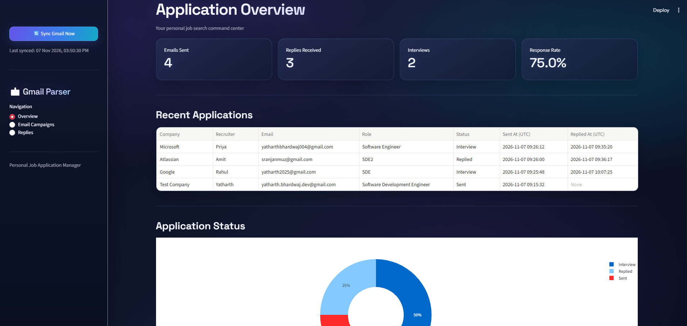
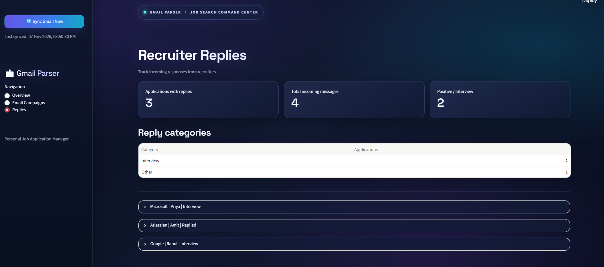

# Gmail Parser --- Personal Job Application Manager

A local-first dashboard for managing recruiter outreach through Gmail.
Prepare personalized job-application emails, send them with your resume
attached, and keep track of recruiter responses from one place.

> **Project status:** Personal project / actively evolving\
> **Deployment:** Runs locally with Streamlit

## Dashboard




## Features

-   **Personalized email campaigns** --- Import recruiter details from a
    CSV and personalize messages with recruiter, company, and role
    placeholders.
-   **Resume attachment** --- Attach a PDF resume to application emails.
-   **Controlled sending** --- Select recipients, limit the batch size,
    set a delay between emails, preview the message, and explicitly
    approve a send batch.
-   **Duplicate protection** --- Avoid sending another application to
    the same recruiter email for the same role when an existing
    application is already recorded.
-   **Gmail reply synchronization** --- Check tracked Gmail conversation
    threads for incoming replies.
-   **Reply classification** --- Categorize detected replies as
    `Positive`, `Interview`, `Rejected`, `Follow-up`, or `Other` using a
    local rule-based classifier.
-   **Application dashboard** --- View sent applications, replies,
    interview count, response rate, and recent application activity.
-   **Response tracking** --- Record reply timestamps, reply counts, and
    first/latest reply content.
-   **Local data storage** --- Store application records in SQLite on
    the machine running the app.

## Tech Stack

  Area                Technology
  ------------------- ------------------
  User interface      Streamlit
  Language            Python
  Email integration   Gmail API
  Authentication      Google OAuth 2.0
  Database            SQLite
  ORM                 SQLAlchemy
  Data handling       Pandas
  Charts              Plotly

## Project Structure

``` text
automatic_gmail_generator/
├── gmail/
│   ├── __init__.py
│   ├── auth.py
│   ├── sender.py
│   ├── reply_tracker.py
│   └── reply_classifier.py
├── assets/
│   └── dashboard.png
├── attachments/             # Local attachments; not committed
├── credentials/             # Local Google OAuth files; not committed
├── data/                    # Local SQLite database; not committed
├── app.py
├── main.py
├── database.py
├── requirements.txt
├── test_gmail.py
└── test_classifier.py
```

The exact local files may vary as the project evolves. Sensitive local
folders should remain excluded from Git.

## Prerequisites

-   Python 3.10 or newer (use a version compatible with the installed
    dependencies).
-   A Google account with Gmail.
-   A Google Cloud project with the Gmail API enabled.
-   A Google OAuth 2.0 **Desktop app** client.

## Setup

### 1. Clone the repository

``` bash
git clone https://github.com/<your-username>/gmail-parser.git
cd gmail-parser
```

### 2. Create and activate a virtual environment

**Windows PowerShell**

``` powershell
python -m venv venv
.\venv\Scripts\Activate.ps1
```

**macOS / Linux**

``` bash
python3 -m venv venv
source venv/bin/activate
```

### 3. Install dependencies

``` bash
pip install -r requirements.txt
```

### 4. Configure Gmail API access

1.  Open the [Google Cloud Console](https://console.cloud.google.com/).

2.  Select or create a Google Cloud project.

3.  Enable the **Gmail API**.

4.  Configure the OAuth consent screen and add your Google account as a
    test user if the app is in Testing mode.

5.  Create an OAuth client ID with application type **Desktop app**.

6.  Download the OAuth client JSON file.

7.  Place it at:

    ``` text
    credentials/credentials.json
    ```

The application creates or uses a local OAuth token file during
authentication. Keep both the client credentials and generated token
private. Never commit them or share them publicly.

The Gmail API scopes used by the application should be reviewed in
`gmail/auth.py`. The application needs permission to send email and read
Gmail messages for reply tracking.

### 5. Run the application

``` bash
python main.py
```

Open the local URL printed by Streamlit in your browser (typically
`http://localhost:8501`).

## Using the Application

### Prepare an email campaign

1.  Open **Email Campaigns**.

2.  Upload a CSV containing these columns:

    ``` csv
    recruiter_name,email,company,role
    Priya,priya@example.com,Example Corp,Software Engineer
    ```

3.  Upload your resume as a PDF.

4.  Edit the subject and body templates.

5.  Use the supported placeholders:

    -   `{recruiter_name}`
    -   `{company}`
    -   `{role}`

6.  Preview the personalized email.

7.  Select recipients and configure the batch size and delay.

8.  Review the recipients, message, and attachment, then explicitly
    approve sending.

Only send relevant, individually reviewed outreach. Follow Gmail
policies and applicable anti-spam requirements.

### Track replies

The application synchronizes Gmail threads associated with recorded
applications. Use **Sync Gmail Now** to trigger a manual check. The
dashboard also performs periodic synchronization while the app is
running.

Detected replies are classified into:

  Category    Meaning
  ----------- ------------------------------------------
  Positive    A potentially encouraging response
  Interview   An interview-related response
  Rejected    A rejection-related response
  Follow-up   A request for more information or action
  Other       No matching rule was detected

Classification is currently **rule-based**, using message text and
keyword matching. It is a convenience, not a guarantee of intent; review
the original email before acting on a classification.

## Data and Privacy

This is a local-first personal utility:

-   Application records are stored in the local SQLite database under
    `data/`.
-   Gmail OAuth client credentials and access tokens are stored locally.
-   Resume files uploaded through the dashboard are stored locally under
    `attachments/`.
-   Gmail access is performed through the configured Google OAuth
    account.

Do not commit or publish:

-   `credentials/credentials.json`
-   `credentials/token.json`
-   Any OAuth token or secret
-   `data/applications.db` or other local database files
-   Resumes or other personal attachments
-   Personal recruiter contact lists

A `.gitignore` file should exclude these files and folders before the
first commit.

## Limitations

-   Gmail synchronization runs only while the local Streamlit
    application is running.
-   Reply tracking is based on Gmail thread IDs recorded for
    applications sent through this app.
-   Rule-based classification can miss context, sarcasm, or wording not
    covered by its keywords.
-   The dashboard does not guarantee email-open or link-click tracking.
-   Google OAuth Testing-mode refresh tokens may have lifecycle
    limitations depending on the configured consent screen and scopes.

## Development Notes

Run the classifier test:

``` bash
python test_classifier.py
```

Run the Gmail integration test only when your local OAuth configuration
is ready:

``` bash
python test_gmail.py
```

The Gmail integration test may access your configured Gmail account.
Review the test code before running it.

## Roadmap

Potential improvements include:

-   More detailed conversation history.
-   Editable application statuses.
-   Follow-up reminders.
-   Improved reply classification and review controls.
-   Additional response-rate and campaign analytics.
-   More robust error handling and send history.

## Security Reminder

**Never upload Gmail OAuth credentials, access tokens, recruiter contact
lists, resumes, or your local database to a public repository.** Keep
the repository private unless the project has been reviewed and all
sensitive data and configuration have been removed.

## License

No license has been added yet. Unless a license is included in the
repository, default copyright rules apply and others do not
automatically receive permission to reuse or distribute the code.
